# Docker 01

## Sistemas de Xestión Empresarial

### DAM 2º

### Gabriela Martinez Menegatty

---

### Parte 1.

Se descargó la imagen de Alpine fijando la versión `3.22`, sin utilizar `latest`.

Comandos utilizados:

`docker pull alpine:3.22`

`docker images` (Para saber qué imagen se había descargado)

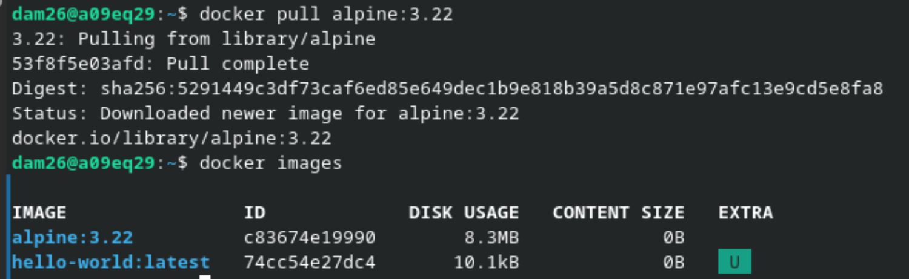

---

### Parte 2.

Al no asignarle un nombre, Docker le crea un "código" propio al contenedor. 
Queda en estado "Created".

Comandos utilizados:

`docker create alpine:3.22`

`docker ps -a` (Para ver los estados).

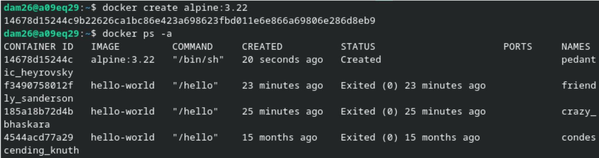

---

### Parte 3.

Para poder crear una Shell con un nombre específico, se necesitan ciertas
opciones.

* -i: permite mantener la entrada interactiva.
* -t: proporciona una terminal.
* --name dam_alp1: asigna el nombre al contenedor.
* alpine:3.22: indica la imagen y versión utilizada.
* /bin/sh: abre una shell dentro del contenedor.

Comando utilizado:

`docker run -it -name dam_alp1 alpine:3.22 /bin/sh`

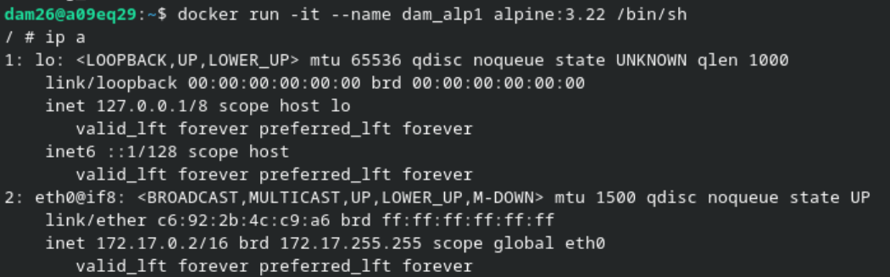

---

### Parte 4.

Primero se conoció la IP de dam_alp1, posteriormente se hizo ping a Google.

Comandos utilizados:

`ip a` (172.17.0.2)

`ping -c 3 google.com`

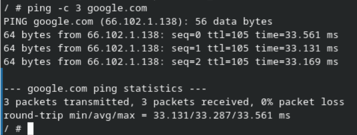

---

### Parte 5.

Primero creamos el contenedor dam_alp2, descubrimos su IP (172.17.0.3). 
Al hacer ping desde dam_alp1 con la IP no tenemos ningún problema,
pero; al hacer ping a "dam_alp2" nos encontramos con un error.

Comandos utilizados:

`docker run -it --name dam_alp2 alpine:3.22 /bin/sh`

`ping -c 3 172.17.0.3`

`ping -c 3 dam_alp2`

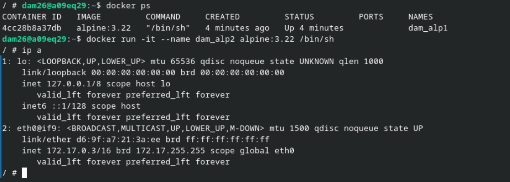
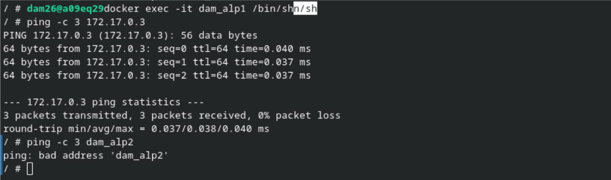

Al encontrar este ERROR, la manera de solucionarlo es a través de una red.
Para unir los contenedores y poder conectarlos.

Comandos utilizados:

`docker network create dam_red`

`docker network connect dam_red dam_alp1` (Para conectar dam_alp1 a la red)

`docker network connect dam_red dam_alp2` (Para conectar dam_alp2 a la red)

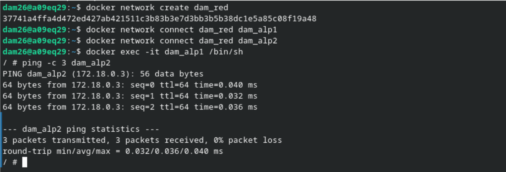

---

### Parte 6.

Para saber cuantos recursos están consumiendo los contenedores,
incluyendo la memoria de cada uno; se usa el siguiente comando de Docker propio.

Comandos utilizados:

`docker stats`

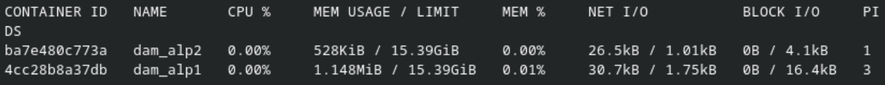

---

### Parte 7.

Cuando Entramos en los contenedores y ejecutamos "exit" lo que sucede es que se detienen
y en los estados ya no aparecen.

Comandos utilizados:

`docker ps`

`docker stats`

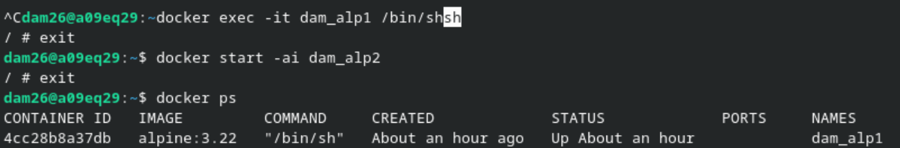
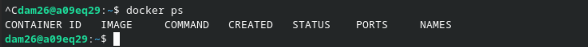
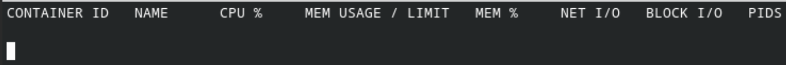

---

### Parte 8.

Para saber que espacio se ha utilizado del disco por Docker.

Comandos utilizados:

`docker system df`

`docker system df -v` (Da información más detallada)

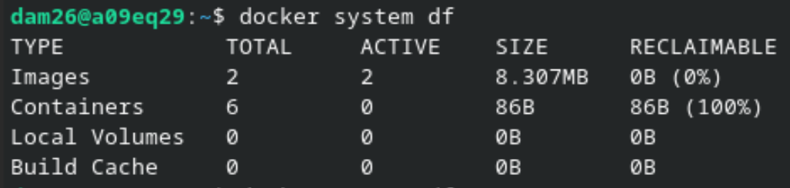
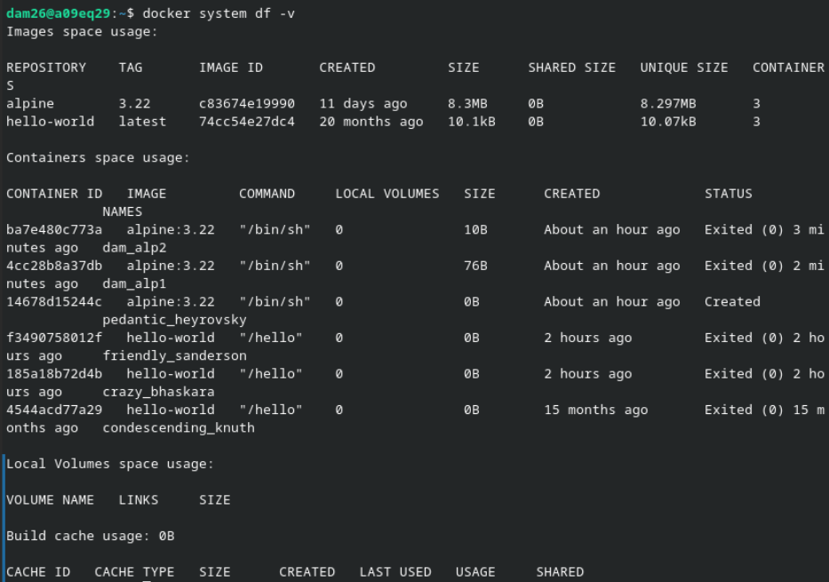

Diferencias:

* Las imágenes son las "librerías" que se pueden descargar en Docker.
* Los contenedores son entornos que se crean a partir de esas imágenes.
